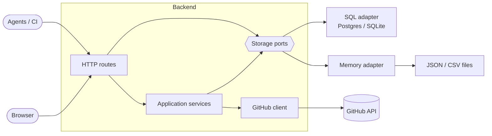

# Architecture

GitHub Control is a React frontend (`front/`) and a Hono backend (`back/`). The backend is written so the same application code runs on two runtimes and on several storage engines.



## Layers

```
back/src/
  config.ts                 AppConfig: settings, whatever their source
  domain/                   Pure rules: repo views, activity vocabulary, service derivation, repo settings baseline, alert rules
  application/
    ports/storage.ts        What the app needs from persistence (interfaces only)
    context.ts              AppContext = { config, storage }
  services/                 Use cases: GitHub refresh, health sync, full sync, signals, service checks, coverage, summaries
  routes/                   HTTP handlers (Hono); read storage from c.var.storage
  http/context.ts           Hono typing and the route -> service bridge
  lib/                      GitHub client, analyzers, signal collectors, metrics helpers, password hashing
  infrastructure/storage/   Storage adapters (see below)
  node/                     Node-only: config resolution, setup wizard API, server composition
  index.ts                  The app. Entry point for Cloudflare Workers
  server.ts                 Entry point for Node / Docker
  cli.ts                    Admin commands (migrate, storage copy/export/import)
```

**Dependency rule.** Routes, services, domain and application never import from `infrastructure/`. They see storage only through the ports. `back/tests/architecture.test.ts` enforces it.

**Composition.** `index.ts` creates the storage once per configuration (`createStorage(config)`) and exposes it as `c.var.storage`. Services receive an `AppContext`.

## Storage

`application/ports/storage.ts` defines sixteen stores (repos, groups, meta, health, apps, coverage, metrics, services, activity, traffic, savedViews, signals, serviceChecks, alerts, alertChannels, admin) grouped in `Storage`.

| Adapter | Location | Used by drivers |
|---|---|---|
| SQL | `infrastructure/storage/sql/` | `postgres`, `sqlite` |
| Memory | `infrastructure/storage/memory/` | `memory` (tests), and the engine of the file stores |
| Files | `infrastructure/storage/file/` | `json`, `csv` |

### One schema definition

`infrastructure/storage/schema.ts` lists every collection, its columns, their defaults and types. Everything else derives from it:

- the SQL tables of both engines (`sql/ddl.ts`),
- complete records in the memory and file stores,
- CSV headers and cell types,
- whole-storage export and import.

### SQL adapter

Each `sql/*.repository.ts` holds the SQL of one store as functions taking a `SqlClient`. The SQL is written once, in standard syntax with `$1` placeholders. The few engine differences (current time, date arithmetic, list aggregation, list parameters) go through `db.dialect`.

Clients (`SqlClient` implementations):

| Client | Engine | Runtime |
|---|---|---|
| `neon-client.ts` | PostgreSQL over Neon's HTTP driver | Cloudflare Workers |
| `pg-client.ts` | PostgreSQL over node-postgres | Node |
| `sqlite-client.ts` | SQLite via `node:sqlite` | Node 22.13+ |

SQLite stores booleans as integers and lists/objects as JSON text; its client converts them on the way in and out, so stores never notice.

### Migrations

`sql/migrate.ts` holds an ordered list of migrations, each with the statements for each engine. On Node they run automatically on first use of the storage; for a Workers deployment run `node dist/cli.mjs migrate` against the database. A database created before migrations existed is adopted at version 1 without being touched.

To change the schema: update `schema.ts`, append a migration (never edit a released one), and extend the contract tests.

### Memory and file adapters

The memory adapter implements every port over arrays, enforcing what a database would (defaults, ids, unique keys, allowed values, `updated_at`). Its whole state is one JSON-serializable object.

The file adapter is the memory adapter plus loading at startup and saving after each write: one file per collection and a `_meta.json`, written atomically (temp file + rename) and one save at a time. It is single-process by design.

### The contract

`back/tests/contract/storage-contract.ts` is one test suite run unchanged against every adapter:

- memory, JSON files, CSV files, SQLite;
- PostgreSQL through the Neon client on a legacy-schema database brought up to date by the migrations;
- PostgreSQL through node-postgres on a database created by the migrations.

PostgreSQL runs embedded in the tests (PGlite), so the SQL is really executed. A new adapter is done when it passes the suite; behaviour not asserted there is not part of the contract.

### Adding an adapter

1. Implement the interfaces of `application/ports/storage.ts`.
2. Register a driver name with `registerStorageDriver` (from `infrastructure/storage/node.ts` if it needs Node).
3. Add a `*.contract.test.ts` that passes a harness to `describeStorageContract`.

## Runtimes

| | Node / Docker (`server.ts`) | Cloudflare Workers (`index.ts`) |
|---|---|---|
| Storage | sqlite, json, csv, postgres | postgres (Neon) |
| Configuration | env vars, then `<DATA_DIR>/config.json`, then the setup wizard | Worker vars and secrets |
| Migrations | automatic | `cli migrate` |
| Full sync | built in, scheduled | external script |
| Service checks | every 15 minutes, on a timer | every 15 minutes, from a Cron Trigger (`scheduled` handler) |
| Frontend | served from `front/dist` | Workers static assets |

### Configuration and first-run setup (Node)

`node/config-store.ts` resolves each setting from the environment first and `<DATA_DIR>/config.json` second. If the GitHub token or the sign-in credentials are missing, `node/server-app.ts` serves the setup API (`node/setup-app.ts`) instead of the app: it requires the one-time code printed in the log, asks only for what is missing, validates the GitHub token, stores a password hash and generated secrets, and then switches to the app without a restart.

### Demo mode (Node)

With `DEMO` set, `node/server-app.ts` skips all of the above: `node/demo.ts` builds a complete configuration (memory storage, sign-in off, a placeholder GitHub token), loads `docs/demo/demo-data.json` with its dates moved to end today, and reloads it on a timer. Nothing touches the data directory. `middleware/demo.ts` then answers 403 to every write except edits of the instance's own data (none at all when `DEMO=readonly`), and to the few reads that call GitHub. `/api/setup/status` reports `demo`, which the frontend shows as a banner.

### Runtime settings

The repo settings baseline is one of these settings: `domain/repo-baseline.ts` holds the catalog of repo settings the app can check and the defaults, and `REPO_BASELINE` (a JSON object) selects which ones are enforced.

`node/settings.ts` implements the `SettingsStore` port (`application/ports/settings.ts`): it validates a change, writes it to `config.json` and updates the live configuration object in place, so nothing restarts. Settings given by an environment variable are reported as locked. The Worker has no such store, and `/api/settings` answers `editable: false` there.

### Syncing

`services/full-sync.service.ts` refreshes the repo list and then syncs each active repo (health analyzers over the file tree, lines of code from the tarball with an estimate as fallback, daily snapshot, monorepo apps, latest CI run, traffic, signals), a few repos at a time. It only uses the ports, so it works on every storage. The Node server starts it when the data is older than `SYNC_INTERVAL_HOURS`.

`back/scripts/unified-sync.ts` (and the Rust clone-based snapshot next to it) is the older, standalone sync that writes to PostgreSQL directly. It remains for Workers deployments, where a full sync does not fit in a request.

### Signals

A signal is data about one repo that is fetched from GitHub and cached: one record per repo and kind in the `repo_signals` collection, with the processed result as JSON. Each kind has a collector in `lib/signals/` (a function from a `SignalContext` to plain data) registered in `SIGNAL_COLLECTORS`; adding a kind is adding an entry there and the UI for it. The context memoizes the repo metadata and file tree, so the collectors of one sync share those calls.

Current kinds: `standards`, `dependencies`, `security`, `release`, `branches`, `ci`, `config`.

`services/signal.service.ts` runs the collectors and stores the results; kinds fail independently, so a missing permission on one does not lose the others. By convention a signal keeps its long detail under `items`: `GET /api/repos` attaches only the summary of each signal to a repo, and `GET /api/repos/:owner/:repo/signals` returns everything. Cross-repo questions (`services/dependency.service.ts`) are answered in application code from the stored signals, so they work the same on every storage.

Two routes act on GitHub from what a signal showed: `routes/branches.ts` (delete branches) and `routes/config.ts` (apply the settings baseline). Both re-read the current state from GitHub before changing anything and log every change.

### Service checks

`services/service-check.service.ts` probes a service, updates its latest status and appends the result to the `service_checks` collection. The same function serves the manual check, the Node timer and the Worker's `scheduled` handler. `GET /api/services/uptime` turns that history into uptime, mean latency, incidents (transitions into "down") and a per-day series.

### Alerts

`domain/alerts.ts` is the rule book: a pure function from the stored state (repos, services, signals) to the conditions that hold right now, each with a stable key such as `ci_failing:acme/api`. `services/alert.service.ts` compares them with the open records of the `alerts` collection and opens, updates or resolves accordingly, so there is no event to miss: whatever changed the data, the next evaluation sees the result. It runs at the end of a full sync and of every round of service checks, one evaluation at a time per storage.

What changed is sent to the `alert_channels` that asked for that kind. A channel type (`lib/alerts/channels.ts`) is a function from a message to one HTTP request, which is why the same code delivers from Node and from the Worker; adding a type is adding an entry to `CHANNEL_TYPES`. Destinations are secrets: the API returns them masked, and an edit that leaves a secret empty keeps the stored one. Digests are sent by the same scheduler that runs the service checks.

## Authentication

- `POST /api/auth/login` checks the username and the password (hash from the wizard, or plain `AUTH_PASSWORD` from the environment) in constant time and returns a 24-hour JWT. Failed attempts are rate limited per client.
- Every other `/api/*` route accepts that JWT or the `API_KEY` as a Bearer token. `CI_COVERAGE_TOKEN` is accepted too, for CI coverage reports.
- `GET /api/health`, `/api/health/ready` and `/api/setup/status` are public.

## Frontend

React 18 with React Router, organized as atomic design (`components/atoms|molecules|organisms|templates`), pages under `pages/`, data hooks under `hooks/`, and the API client in `lib/api.ts`. On load it asks `/api/setup/status` and routes to the wizard when the server is not configured.

## Testing

- `back/`: Vitest. Route tests, service tests, the storage contract, the Node server and CLI. Coverage thresholds are enforced in CI.
- `front/`: Vitest + Testing Library; Playwright specs under `front/e2e/`.
