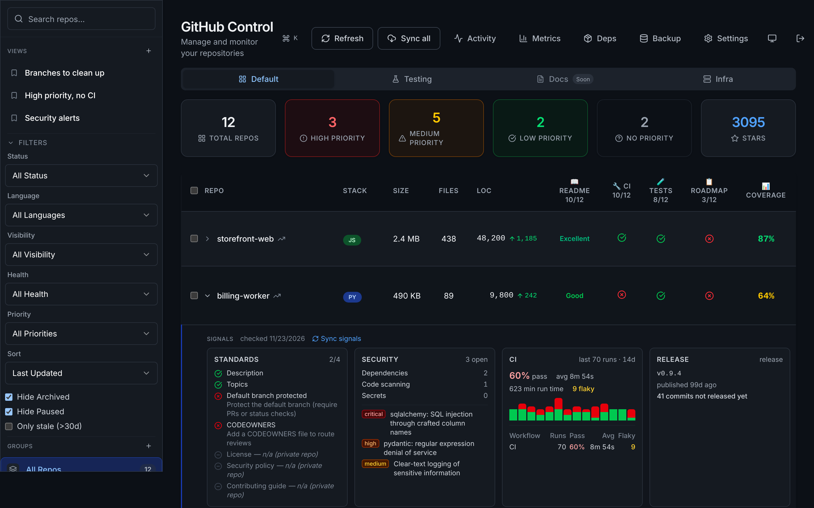
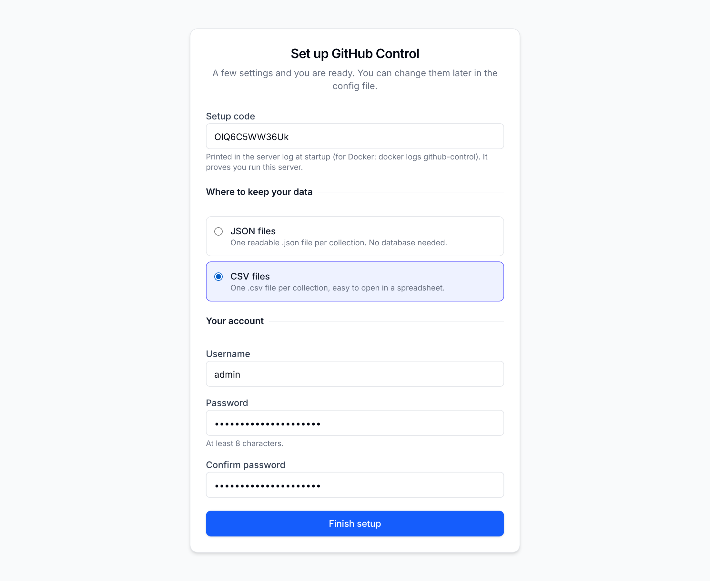
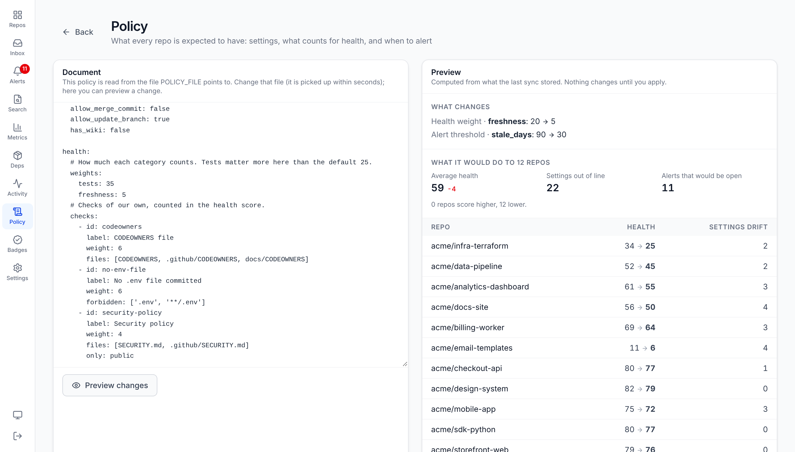
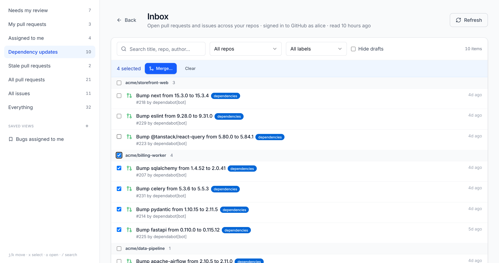
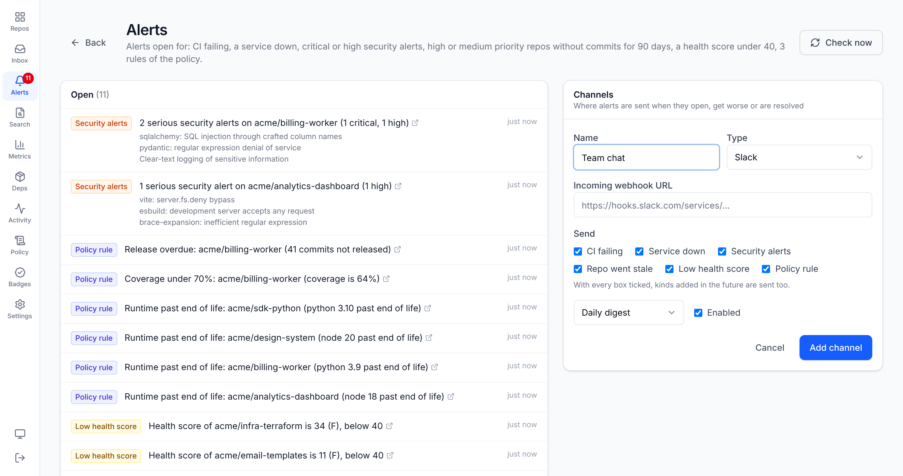
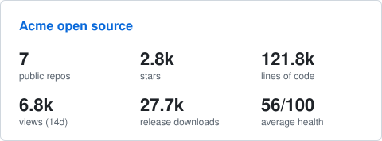
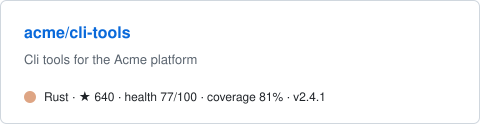
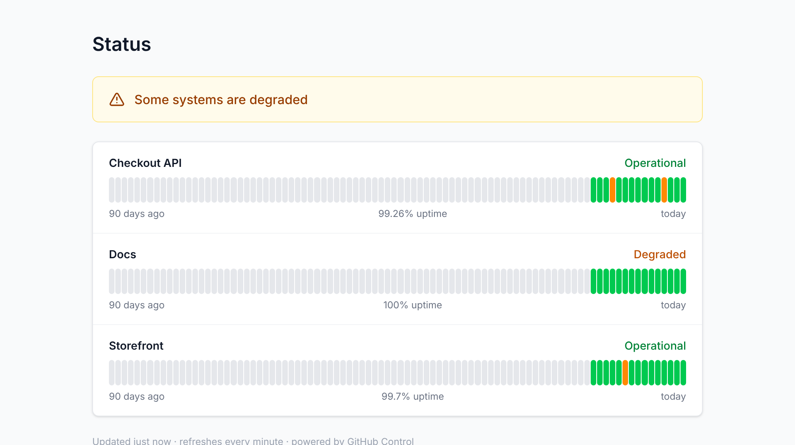

# GitHub Control

A self-hosted dashboard to see, organize and keep healthy **all** your GitHub repositories: yours, your collaborations and your organizations', in one place.


GitHub shows you one repository at a time. GitHub Control answers the questions that span all of them: which repos have no CI or tests, which ones are stale, how each one has grown, what is deployed where, and what you decided to do next with each.

## Try it in 30 seconds

No GitHub token and nothing to set up: this starts the dashboard on a fictional dataset, kept in memory.

```bash
docker run --rm -p 13337:13337 -e DEMO=true ghcr.io/pabloalaniz/github-control
```

Open http://localhost:13337. From a clone, without Docker: `DEMO=true npm start`.

## Features

- **Every repo in one table**: stars, size, lines of code, language, last activity, visibility, with search, filters and sorting.
- **Health at a glance**: README, CI, tests, coverage, roadmap, docs quality and a composite health score per repo; latest CI run status.
- **Saved views and shareable filters**: the tab and filters live in the URL; name a combination and get back to it in one click.
- **Keyboard first**: a command palette (`Cmd/Ctrl+K`) to jump to a repo, group, view or action, and `j`/`k`/`x`/`o` to move through the table.
- **Light and dark**: follows your system, or pick one from the header.
- **Signals from GitHub** per repo, refreshed by every sync:
  - a *standards* checklist (description, topics, protected default branch, CODEOWNERS and, for public repos, license, security policy and contributing guide) that also counts toward the health score;
  - open *security alerts* (dependencies, code scanning, secrets) by severity;
  - the latest *release* and how many commits are still unreleased;
  - *branch hygiene*: merged-but-not-deleted and stale branches and idle pull requests, with a guarded cleanup;
  - *CI reliability*: success rate, duration and flaky commits per workflow;
  - *settings drift* against a baseline you define, fixable per repo or in bulk.
- **Dependency inventory**: which repos use each package and at what version, diverging major versions, and runtimes past their end of life.
- **Organize your way**: groups with colors, priorities (high / medium / low / paused), status, notes, next action and blockers, with bulk actions.
- **Traffic history**: GitHub only keeps 14 days of views, clones, referrers and popular paths; every sync saves them, so your history keeps growing.
- **History**: a daily snapshot per repo (LOC, files, stars, issues, health) with charts and date-to-date comparison.
- **Monorepo aware**: detects apps inside a repo and tracks each one's health and coverage.
- **Services**: the deployed URLs behind your repos, health-checked every 15 minutes (configurable), with uptime, latency and incident history.
- **Code search**: look for a word, a function or a config key in the code of all your repos at once.
- **Inbox**: the open pull requests and issues of every repo in one list, with sections (needs my review, mine, assigned to me, dependency updates, stale), filters you can save, keyboard navigation and guarded bulk merge.
- **Public surface** (opt-in): badges and cards for your READMEs, a summary card of your open source work, and a status page for your services.
- **Alerts**: know when CI breaks, a service goes down, a serious security alert appears, a repo you care about goes stale or a health score drops, in Slack, Discord, Telegram, ntfy or any webhook, with an optional daily or weekly digest.
- **Coverage from CI**: a workflow step reports coverage per repo or per app.
- **AI summaries** (optional): a structured summary of a repo's README using the Claude API.
- **Policy as code**: the settings baseline, what counts for the health score, checks of your own and the alert thresholds in one YAML document, with a dry run that shows what a change would do before you apply it.
- **API and MCP for agents and CI**: everything in the UI is available over HTTP with an API key, the dashboard is an MCP server your coding agent can use as tools, and an activity log records who changed what.
- **Your data, your storage**: SQLite, JSON files, CSV files or PostgreSQL. Switch between them with one command.




## Quick start

No environment variables and no database to set up: the first time you open the app, a setup wizard asks for what it needs.

### Docker

With the published image (amd64 and arm64, so it runs on a Raspberry Pi with a 64-bit OS):

```bash
docker run -d --name github-control --restart unless-stopped \
  -p 13337:13337 -v github-control-data:/data ghcr.io/pabloalaniz/github-control
docker logs github-control      # prints the one-time setup code
```

Or with Docker Compose, which also reads a `.env` file:

```bash
mkdir github-control && cd github-control
curl -fsSLO https://raw.githubusercontent.com/PabloAlaniz/github-control/main/docker-compose.image.yml
docker compose -f docker-compose.image.yml up -d
docker logs github-control      # prints the one-time setup code
```

Or building from source:

```bash
git clone https://github.com/PabloAlaniz/github-control.git
cd github-control
docker compose up -d
docker logs github-control      # prints the one-time setup code
```

Open http://localhost:13337, enter the setup code and follow the wizard:



1. **Where to keep your data**: a SQLite database (recommended), JSON files or CSV files.
2. **GitHub access**: a personal access token with the `repo` scope and, optionally, organizations to include.
3. **Your account**: the username and password you will sign in with.

When the wizard finishes, the first sync starts on its own. Configuration and data live in the `/data` volume.

### Updating

Your configuration and data live in the `/data` volume, so updating only replaces the app. Schema migrations are applied on start.

```bash
# published image
docker compose -f docker-compose.image.yml pull && docker compose -f docker-compose.image.yml up -d

# built from source
git pull && docker compose up -d --build
```

Images are published for every release tag. `latest` follows the newest release; set `GITHUB_CONTROL_VERSION` (for example `1.2.0`) to pin one. To update unattended, run the two commands from cron or a systemd timer on the server itself; nothing has to reach your server from outside.

### Node (no Docker)

Requires Node.js 22.13 or newer.

```bash
npm install
npm start          # builds the frontend and the server, then serves http://localhost:13337
```

Data is kept in `back/data/` (change it with `DATA_DIR`).

### Demo mode

`DEMO=true` starts the server on the bundled fictional dataset instead of your repositories: no setup wizard, no sign-in, no GitHub token. The data lives in memory, nothing is read from or written to the data directory, and its dates always end today.

```bash
DEMO=true npm start
```

Visitors can edit what belongs to the dashboard (notes, priorities, groups, saved views); the dataset is reloaded every hour, so their changes go away. Whatever would need GitHub (syncing, branch cleanup, applying settings) answers that it is not available in the demo.

To host a public demo, use `DEMO=readonly`: nothing can be changed at all.

| Variable | Purpose | Default |
|---|---|---|
| `DEMO` | `true` (editable) or `readonly` | off |
| `DEMO_RESET_MINUTES` | Minutes between reloads of the dataset; `0` never reloads | `60` |
| `DEMO_DATA` | Path to the dataset, a file made by `storage export` | the bundled `docs/demo/demo-data.json` |

To keep a copy of the demo data in a real storage instead, import it: `node back/dist/cli.mjs storage import --in docs/demo/demo-data.json --rebase-dates true`.

## Configuration

Every setting can also be given as an environment variable. Variables win over the wizard's answers, and the wizard does not ask for what the environment already provides. With `GITHUB_TOKEN`, `AUTH_USERNAME` and `AUTH_PASSWORD` set, the wizard never appears.

Settings that describe what you expect of your repos (the baseline, health weights, alert thresholds) are better kept in the [policy](#policy).

| Variable | Purpose | Default |
|---|---|---|
| `STORAGE_DRIVER` | `sqlite`, `json`, `csv` or `postgres` | `json` (`postgres` if `DATABASE_URL` is set) |
| `STORAGE_PATH` | SQLite file, or directory for JSON/CSV | inside `DATA_DIR` |
| `DATABASE_URL` | PostgreSQL connection string | |
| `GITHUB_TOKEN` | Personal access token (`repo` scope) | asked by the wizard |
| `GITHUB_ORGS` | Comma-separated organizations to include | none |
| `AUTH_USERNAME`, `AUTH_PASSWORD` | Sign-in credentials | asked by the wizard (stored hashed) |
| `JWT_SECRET`, `API_KEY` | Session signing secret and API key | generated and saved |
| `SYNC_INTERVAL_HOURS` | Hours between automatic full syncs; `0` disables | `24` |
| `SERVICE_CHECK_MINUTES` | Minutes between service health checks (1 to 1440) | `15` |
| `ALERT_STALE_DAYS` | Days without commits before a high or medium priority repo raises an alert; `0` turns it off | `90` |
| `ALERT_HEALTH_BELOW` | Health score under which a repo raises an alert; `0` turns it off | `40` |
| `PUBLIC_BADGES` | `true` serves public SVG badges and cards for public repos | off |
| `PUBLIC_STATUS` | `true` serves the public status page of your services at `/status` | off |
| `POLICY_FILE` | Path to the policy document (YAML). The file is then the source of truth | none |
| `POLICY` | The policy document itself (YAML or JSON) | none |
| `REPO_BASELINE` | JSON object `{ "setting": true/false }`: the repo settings every repo is expected to have. Superseded by the policy's `baseline` | a small default set |
| `ANTHROPIC_API_KEY` | Enables AI summaries | off |
| `CI_COVERAGE_TOKEN` | Token CI uses to report coverage | off |
| `DATA_DIR`, `PORT`, `HOST` | Where data lives and where to listen | `./data`, `13337`, `0.0.0.0` |
| `TRUST_PROXY` | `true` to take the client address from `X-Forwarded-For` | off |
| `DISABLE_AUTH` | `true` turns sign-in off. Local use only. | off |

The GitHub token, organizations, sync interval, badges, the status page, the repo settings baseline and your password can also be changed later from the **Settings** page (settings given as environment variables appear there as locked).

See [`.env.example`](.env.example).

## Storage

| Driver | Runs on | Notes |
|---|---|---|
| `sqlite` | Node / Docker | One database file. Recommended for self-hosting. Uses Node's built-in SQLite: nothing to compile. |
| `json` | Node / Docker | One readable `.json` file per collection. |
| `csv` | Node / Docker | One `.csv` file per collection; opens in any spreadsheet. |
| `postgres` | Node / Docker, Cloudflare Workers | Any PostgreSQL. On Node the schema is created and migrated automatically. |

The JSON and CSV stores are meant for a single running instance and rewrite a collection's file when it changes; for long histories or many repos prefer SQLite or PostgreSQL.

### Moving between storages, backups

```bash
cd back
node dist/cli.mjs storage copy --from json:./data/storage --to sqlite:./data/github-control.db
node dist/cli.mjs storage export --out backup.json
node dist/cli.mjs storage import --in backup.json
node dist/cli.mjs migrate          # apply pending schema migrations (SQL drivers)
```

A target is `current` (the configured storage), `sqlite:<file>`, `json:<dir>`, `csv:<dir>` or `postgres:<url>`. In Docker: `docker exec github-control node back/dist/cli.mjs ...`.

## Syncing

A **full sync** refreshes the repository list from GitHub and then updates health, code metrics, the daily snapshot, monorepo apps, CI status, traffic and signals for every active repo. Traffic is only available for repositories your token has push access to.

Signals degrade gracefully with the token's permissions: security alerts need read access to them, deleting branches and merging pull requests need write access to the repository, and reading or changing repo settings needs admin access. Without a permission, that signal is shown as not available instead of failing the sync.

- On the Node server it runs automatically every `SYNC_INTERVAL_HOURS`, and right after setup.
- Start one by hand with `POST /api/sync`; follow it with `GET /api/sync/status`.
- The **Sync all** button in the dashboard does the same and shows progress; **Refresh** only refreshes the repository list.
- The signals of one repo (or of the selected repos) can be refreshed on their own from the dashboard, or with `POST /api/repos/:owner/:repo/signals/sync`.

### What changes on GitHub

Almost everything is read-only. Three actions write to GitHub, all only when you ask and all recorded in the activity log:

- **Branch cleanup** deletes the branches you select. The server re-checks each one first and never deletes the default branch, a protected branch, or a branch that moved since it was listed.
- **Merging pull requests** from the inbox. The server re-checks each one first and skips it if it is closed, a draft, has new commits since it was listed, or has failing or running checks. GitHub's own rules (required reviews, conflicts, branch protection) still apply.
- **Applying the settings baseline** changes only the settings that differ. Review the baseline in **Settings** before applying it in bulk.

## Policy



What you expect of every repo lives in one YAML document, on the **Policy** page:

```yaml
version: 1

baseline:                 # repo settings every repo must have (drift is shown per repo and can be fixed in bulk)
  delete_branch_on_merge: true
  allow_merge_commit: false
  has_wiki: false

health:
  weights:                # how much each category counts; relative to each other
    tests: 35             # ci, tests, docs, quality, hygiene, freshness, custom
    freshness: 10
  checks:                 # checks of your own, counted in the health score
    - id: codeowners
      label: CODEOWNERS file
      weight: 6
      files: [CODEOWNERS, .github/CODEOWNERS]     # passes when one exists
    - id: no-env-file
      label: No .env file committed
      weight: 6
      forbidden: ['.env', '**/.env']              # passes when none exists
      only: public                                # or: private

alerts:
  stale_days: 90
  health_below: 40
  rules:                    # alerts of your own: one per repo where the condition holds
    - id: low-coverage
      label: Coverage under 70%
      when: { coverage_below: 70 }
      priority: [high]      # optional: high, medium, low, none
    - id: missing-codeowners
      label: No CODEOWNERS
      when: { check: codeowners }
      only: public          # optional: public or private

signals:
  openssf_scorecard: true   # fetch the OpenSSF Scorecard of public repos
```

A rule watches exactly one condition:

| Condition | Holds when |
|---|---|
| `check: <id>` | that custom check fails |
| `coverage_below: N` | test coverage is under N % |
| `ci_success_below: N` | CI passes less than N % of the time |
| `unreleased_commits_over: N` | more than N commits are not in the latest release |
| `settings_drift_over: N` | more than N settings differ from the baseline |
| `scorecard_below: N` | the OpenSSF Scorecard is under N (0 to 10) |
| `eol_runtime: true` | the repo declares a runtime past its end of life |

Rule alerts show up with the others, as the kind "Policy rule", and go to the same channels.

Every section is optional; what you leave out keeps its default. A complete example is in [`docs/demo/policy.yml`](docs/demo/policy.yml).

**Preview changes** is a dry run: it validates the document and shows what it changes, how the health score of each repo would move, how many settings would be out of line and how many alerts would be open, all computed from what the last sync stored. Nothing changes until you press **Apply**. New checks and newly enforced settings are read from GitHub at the next sync.

To keep the policy **under version control**, put it in a file and point `POLICY_FILE` at it (for example a file from a repo, mounted into the container). The file is then the only way to change the policy: the server re-reads it within seconds of a change, ignores an edit that is not valid, and the page becomes preview-only. `POLICY` takes the document itself as an environment variable (the way to set it on Cloudflare Workers).

The OpenSSF Scorecard is off unless the policy turns it on. When on, each sync asks `api.securityscorecards.dev` about your **public** repos (their names are sent to that service; private repos are never asked about) and shows the score and its weakest checks on the repo.

## MCP server

GitHub Control is also an [MCP](https://modelcontextprotocol.io) server, so a coding agent can ask it about your repos instead of you copying things over. It speaks the Streamable HTTP transport at `/api/mcp`, authenticated with the API key. Any MCP client that supports that transport can connect with the URL and an `Authorization: Bearer <API_KEY>` header; for example, with Claude Code:

```bash
claude mcp add --transport http github-control https://your-server.example/api/mcp \
  --header "Authorization: Bearer $API_KEY"
```

| Tool | What it does |
|---|---|
| `list_repos` | Repos with health, CI, priority and last commit; filter by text, priority, language, CI state or health |
| `get_repo` | One repo in full: metadata, notes, health breakdown and signals |
| `list_alerts` | Open (or resolved) alerts |
| `get_inbox` | Open pull requests and issues; filter by type, repo or requested reviewer |
| `list_dependencies` | Packages and versions across repos, diverging majors, end-of-life runtimes |
| `list_services` | Services with their state and uptime |
| `search_code` | Search the code of the tracked repos on GitHub |
| `get_policy`, `plan_policy` | The policy in force, and a dry run of a new one |
| `update_repo` | Set a repo's priority, next action or notes in the dashboard |

The tools read what the dashboard already knows without calling GitHub, except `search_code`, which searches on GitHub live. Only `update_repo` changes anything (the dashboard's own notes, never GitHub). Each call goes through the same API as everything else, so it is logged in the activity log as an agent.

## Code search

**Search code** (under the repo search box, or from the command palette) looks for text in the default branch of every repo on the dashboard and shows the files and lines that match, grouped by repo. It can be narrowed to one repo or one language, and GitHub's qualifiers work too: `"exact phrase"`, `path:src`, `filename:Dockerfile`, `extension:yml`.

This is the one page that asks GitHub when you use it, because code is not something a sync can cache. It uses GitHub's code search, which allows about 10 searches a minute and returns the first 50 files. Repos you archived, paused or do not track are left out of the results.

## Inbox



The **Inbox** lists the open pull requests and issues of all your active repos. Every sync reads them, and **Refresh** reads them again on demand; opening the page costs no GitHub calls.

- **Sections** are ready-made questions: what needs my review, my pull requests, what is assigned to me, what is ready to merge (green checks, no review pending), dependency updates (Dependabot, Renovate), pull requests nobody touched in 30 days, all pull requests, all issues. "Me" is the account the GitHub token belongs to.
- **Filters** by text, repo, label and draft state live in the URL. Name a combination to keep it under *Saved views*.
- **Keyboard**: `j`/`k` to move, `x` to select, `o` or `Enter` to open on GitHub, `/` to search.
- **Merge** the selected pull requests in one go: dependency updates are grouped by repo so a whole repo can be selected at once.

Each pull request shows whether its checks pass, fail or are still running, and where its review stands. It keeps the 100 most recently updated open items of each repo.

## Alerts



After every sync and every round of service checks, GitHub Control compares what it knows with the alerts that are open. An alert opens when one of these starts to hold, and is resolved when it stops:

| Alert | Opens when |
|---|---|
| CI failing | the latest workflow run on the default branch failed |
| Service down | a service's health check found it down |
| Security alerts | a repo has open alerts of critical or high severity; it speaks again when there are more |
| Repo went stale | a repo with high or medium priority has had no commits for `ALERT_STALE_DAYS` days (default 90) |
| Low health score | a repo's health score is under `ALERT_HEALTH_BELOW` (default 40) |

Archived and paused repos never raise alerts. Open and recently resolved alerts are listed on the **Alerts** page (the bell in the header) whether or not anything is sent anywhere.

To be told, add a **channel** on that page: Slack, Discord, Telegram, ntfy, email over SMTP, or a generic webhook that receives JSON. Each channel chooses which kinds of alert it gets, and can also get a daily or weekly digest of what is open. A channel hears when an alert opens or gets worse, and when CI or a service recovers. What was already wrong when you add a channel is not sent: only what changes from then on.

```json
{ "source": "github-control", "event": "opened", "kind": "ci_failing", "entity": "acme/api",
  "title": "CI is failing on acme/api", "url": "https://github.com/acme/api/actions/runs/1",
  "level": 0, "detail": { "branch": "main" }, "at": "2026-01-01T00:00:00.000Z", "text": "..." }
```

`event` is `opened`, `worsened`, `resolved`, `digest` or `test`.

Email needs an SMTP server: host, port (587 by default, 465 for implicit TLS), an optional username and password, a sender and up to 20 recipients. It is available on the Node server and Docker, not on Cloudflare Workers, which cannot open SMTP connections.

Service checks run every 15 minutes; set `SERVICE_CHECK_MINUTES` to check more often (an outage shorter than the interval can go unnoticed). On Cloudflare Workers the interval is the Cron Trigger in `back/wrangler.toml`, which also drives alerts and digests.

## Badges and cards

With `PUBLIC_BADGES=true`, the server exposes SVG images you can embed in a README. They need no authentication, so they only exist for **public** repositories; a private repo answers like one that does not exist, and the summary counts public repos only.





```markdown


```

- **Badges**: `stars`, `views` and `clones` (last 14 days), `loc`, `coverage`, `health`, `ci`, `release`, `downloads` (of the files attached to releases). `?label=` replaces the left text and `?style=flat-square` removes the rounded corners.
- **Cards**: `card.svg` for one repo and `summary.svg` for all of them. `?theme=light` or `?theme=dark` fixes the colors; by default a card follows the reader's system theme. The summary also takes `?title=`.

The **Badges and embeds** page (command palette, or the *Badges* link on a public repo) previews each one and gives you the Markdown to copy.

## Status page



With `PUBLIC_STATUS=true`, `/status` is a page anyone can open, without signing in: whether everything is up, and for each active service its current state and 90 days of history. It shows names and states only, never URLs, providers or repos. Deactivate a service to keep it off the page.

```markdown
[](https://your-server.example/status)

```

`GET /api/status` returns the same data as JSON. Both switches are also on the **Settings** page.

## API

Everything the UI does goes through the HTTP API. Authenticate with `Authorization: Bearer <API_KEY>` (the key is in `config.json`, or set `API_KEY` yourself), or with the token returned by `POST /api/auth/login`.

```bash
curl -H "Authorization: Bearer $API_KEY" "http://localhost:13337/api/repos/filter?has_ci=false"
curl -H "Authorization: Bearer $API_KEY" http://localhost:13337/api/views/backlog
curl -X POST -H "Authorization: Bearer $API_KEY" http://localhost:13337/api/sync
```

| Area | Endpoints |
|---|---|
| Repos | `GET /api/repos`, `/api/repos/filter`, `/api/repos/:owner/:repo`, `POST /api/repos/refresh`, priority / status / blockers / archive |
| Views | `GET /api/views/{backlog,health,needs-ci,needs-tests,needs-docs,needs-roadmap,almost-done}` |
| Groups | `GET/POST /api/groups`, `PUT/DELETE /api/groups/:id`, `POST/DELETE /api/groups/:id/repos` |
| Meta | `GET/PATCH /api/meta/:owner/:repo`, `POST /api/meta/bulk` |
| Health & docs | `POST /api/repos/:owner/:repo/health/sync`, `/ci-status/sync`, `GET .../readme`, `POST .../generate-summary` |
| Coverage | `GET/POST /api/repos/:owner/:repo/coverage` |
| Metrics | `GET /api/metrics/{aggregate,latest,compare}`, `/api/metrics/repo/:owner/:repo`, `/api/metrics/snapshot/:date` |
| Traffic | `GET /api/traffic/summary`, `/api/traffic/repo/:owner/:repo`, `POST /api/traffic/repo/:owner/:repo/sync` |
| Signals | `GET /api/repos/:owner/:repo/signals`, `POST .../signals/sync?kinds=`, `POST .../branches/delete`, `POST .../config/apply` |
| Dependencies | `GET /api/dependencies` |
| Public (no sign-in, opt-in) | `GET /api/badges/:owner/:repo/:metric.svg`, `.../card.svg`, `/api/badges/summary.svg`, `GET /api/status`, `/api/status/badge.svg` |
| Search | `GET /api/search/code?q=&repo=&language=` |
| Policy | `GET /api/policy`, `POST /api/policy/plan`, `PUT /api/policy` |
| MCP | `POST /api/mcp` |
| Inbox | `GET /api/inbox`, `POST /api/inbox/refresh`, `POST /api/inbox/merge` |
| Alerts | `GET /api/alerts?status={open,resolved,all}`, `POST /api/alerts/evaluate`, `GET/POST /api/alerts/channels`, `PUT/DELETE /api/alerts/channels/:id`, `POST /api/alerts/channels/:id/test` |
| Saved views | `GET/POST /api/saved-views`, `DELETE /api/saved-views/:id` |
| Services & apps | `/api/services`, `GET /api/services/uptime`, `/api/repo-apps` |
| Activity | `GET /api/activity`, `/api/activity/stats/by-actor`, `/api/activity/stats/by-day` |
| Sync & backup | `POST /api/sync`, `GET /api/sync/status`, `GET /api/export`, `POST /api/import` |
| Settings | `GET/PATCH /api/settings` (Node server) |

Reporting coverage from a workflow is described in [`back/docs/ci-coverage-setup.md`](back/docs/ci-coverage-setup.md).

## Deploying to Cloudflare Workers

The same app runs as a Cloudflare Worker with PostgreSQL (for example Neon). In that setup configuration comes from Worker secrets (there is no wizard), and the schema is migrated from your machine:

```bash
cd back
DATABASE_URL=postgresql://... STORAGE_DRIVER=postgres node dist/cli.mjs migrate
wrangler secret put DATABASE_URL      # plus GITHUB_TOKEN, API_KEY, AUTH_USERNAME, AUTH_PASSWORD, JWT_SECRET
npm run deploy                        # from the repo root
```

Workers cannot run a full sync within their time limits; schedule `back/scripts/unified-sync.ts` externally (PostgreSQL only). The service health checks do run on Workers, from a Cron Trigger declared in `back/wrangler.toml`; triggers are applied by `wrangler deploy` or `wrangler triggers deploy`, not by `wrangler versions upload`. See [`ARCHITECTURE.md`](ARCHITECTURE.md).

## Development

```bash
npm install
npm run dev          # frontend on :13338, backend (wrangler) on :13337
npm run test:all     # frontend and backend tests
```

- `front/`: React 18, Vite, Tailwind CSS 4.
- `back/`: Hono. Runs on Node and on Cloudflare Workers.
- Storage adapters are held to one contract test suite (`back/tests/contract/`), run against every adapter.

[`ARCHITECTURE.md`](ARCHITECTURE.md) explains the layers and how to add a storage adapter or a schema migration. See [`CONTRIBUTING.md`](CONTRIBUTING.md) and the [`ROADMAP.md`](ROADMAP.md).

## Security notes

- Sign-in passwords set through the wizard are stored hashed (PBKDF2-SHA256). Repeated failed sign-ins are rate limited per client.
- `config.json` holds your GitHub token in plain text with owner-only permissions. Protect the data directory like any other secret.
- Alert channel destinations (webhook URLs, bot tokens) are kept in the storage. The API and the UI only show their last characters, but they are in the database and in `storage export` files: treat both as secrets.
- An unconfigured instance can be claimed by whoever reaches it first, which is why setup requires the code printed in the server log. Finish setup before exposing the server.
- Put a TLS-terminating reverse proxy in front of the server for anything beyond localhost.

## License

[MIT](LICENSE)
