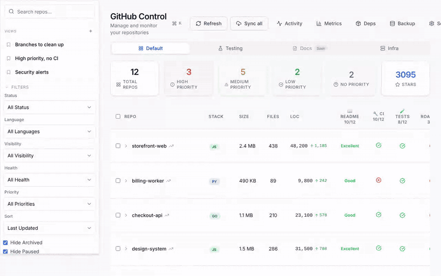
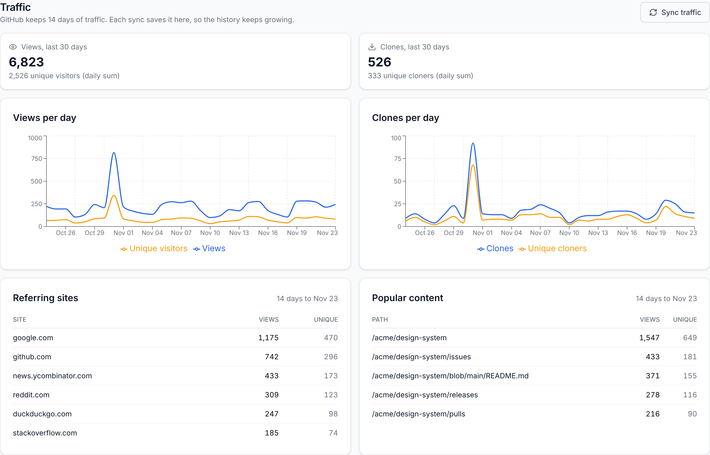

# GitHub Control

A self-hosted dashboard to see, organize and keep healthy **all** your GitHub repositories: yours, your collaborations and your organizations', in one place.



GitHub shows you one repository at a time. GitHub Control answers the questions that span all of them: which repos have no CI or tests, which ones are stale, how each one has grown, what is deployed where, and what you decided to do next with each.

## Try it in 30 seconds

No GitHub token and nothing to set up: this starts the dashboard on a fictional dataset, kept in memory.

```bash
docker run --rm -p 13337:13337 -e DEMO=true ghcr.io/pabloalaniz/github-control
```

Open http://localhost:13337. From a clone, without Docker: `DEMO=true npm start`.

## Features

- **Every repo in one table**: stars, size, lines of code, language, last activity, visibility, with search, filters and sorting.
- **Health at a glance**: README, CI, tests, coverage, roadmap, docs quality and a composite health score per repo; latest CI run status.
- **Saved views and shareable filters**: the tab and filters live in the URL; name a combination and get back to it in one click.
- **Keyboard first**: a command palette (`Cmd/Ctrl+K`) to jump to a repo, group, view or action, and `j`/`k`/`x`/`o` to move through the table.
- **Light and dark**: follows your system, or pick one from the header.
- **Signals from GitHub** per repo, refreshed by every sync:
  - a *standards* checklist (description, topics, protected default branch, CODEOWNERS and, for public repos, license, security policy and contributing guide) that also counts toward the health score;
  - open *security alerts* (dependencies, code scanning, secrets) by severity;
  - the latest *release* and how many commits are still unreleased;
  - *branch hygiene*: merged-but-not-deleted and stale branches and idle pull requests, with a guarded cleanup;
  - *CI reliability*: success rate, duration and flaky commits per workflow;
  - *settings drift* against a baseline you define, fixable per repo or in bulk.
- **Dependency inventory**: which repos use each package and at what version, diverging major versions, and runtimes past their end of life.
- **Organize your way**: groups with colors, priorities (high / medium / low / paused), status, notes, next action and blockers, with bulk actions.
- **Traffic history**: GitHub only keeps 14 days of views, clones, referrers and popular paths; every sync saves them, so your history keeps growing.
- **History**: a daily snapshot per repo (LOC, files, stars, issues, health) with charts and date-to-date comparison.
- **Monorepo aware**: detects apps inside a repo and tracks each one's health and coverage.
- **Services**: the deployed URLs behind your repos, health-checked every 15 minutes, with uptime, latency and incident history.
- **Coverage from CI**: a workflow step reports coverage per repo or per app.
- **AI summaries** (optional): a structured summary of a repo's README using the Claude API.
- **API for agents and CI**: everything in the UI is available over HTTP with an API key, plus an activity log of who changed what.
- **Your data, your storage**: SQLite, JSON files, CSV files or PostgreSQL. Switch between them with one command.




## Quick start

No environment variables and no database to set up: the first time you open the app, a setup wizard asks for what it needs.

### Docker

With the published image (amd64 and arm64, so it runs on a Raspberry Pi with a 64-bit OS):

```bash
docker run -d --name github-control --restart unless-stopped \
  -p 13337:13337 -v github-control-data:/data ghcr.io/pabloalaniz/github-control
docker logs github-control      # prints the one-time setup code
```

Or with Docker Compose, which also reads a `.env` file:

```bash
mkdir github-control && cd github-control
curl -fsSLO https://raw.githubusercontent.com/PabloAlaniz/github-control/main/docker-compose.image.yml
docker compose -f docker-compose.image.yml up -d
docker logs github-control      # prints the one-time setup code
```

Or building from source:

```bash
git clone https://github.com/PabloAlaniz/github-control.git
cd github-control
docker compose up -d
docker logs github-control      # prints the one-time setup code
```

Open http://localhost:13337, enter the setup code and follow the wizard:


1. **Where to keep your data**: a SQLite database (recommended), JSON files or CSV files.
2. **GitHub access**: a personal access token with the `repo` scope and, optionally, organizations to include.
3. **Your account**: the username and password you will sign in with.

When the wizard finishes, the first sync starts on its own. Configuration and data live in the `/data` volume.

### Updating

Your configuration and data live in the `/data` volume, so updating only replaces the app. Schema migrations are applied on start.

```bash
# published image
docker compose -f docker-compose.image.yml pull && docker compose -f docker-compose.image.yml up -d

# built from source
git pull && docker compose up -d --build
```

Images are published for every release tag. `latest` follows the newest release; set `GITHUB_CONTROL_VERSION` (for example `1.2.0`) to pin one. To update unattended, run the two commands from cron or a systemd timer on the server itself; nothing has to reach your server from outside.

### Node (no Docker)

Requires Node.js 22.13 or newer.

```bash
npm install
npm start          # builds the frontend and the server, then serves http://localhost:13337
```

Data is kept in `back/data/` (change it with `DATA_DIR`).

### Demo mode

`DEMO=true` starts the server on the bundled fictional dataset instead of your repositories: no setup wizard, no sign-in, no GitHub token. The data lives in memory, nothing is read from or written to the data directory, and its dates always end today.

```bash
DEMO=true npm start
```

Visitors can edit what belongs to the dashboard (notes, priorities, groups, saved views); the dataset is reloaded every hour, so their changes go away. Whatever would need GitHub (syncing, branch cleanup, applying settings) answers that it is not available in the demo.

To host a public demo, use `DEMO=readonly`: nothing can be changed at all.

| Variable | Purpose | Default |
|---|---|---|
| `DEMO` | `true` (editable) or `readonly` | off |
| `DEMO_RESET_MINUTES` | Minutes between reloads of the dataset; `0` never reloads | `60` |
| `DEMO_DATA` | Path to the dataset, a file made by `storage export` | the bundled `docs/demo/demo-data.json` |

To keep a copy of the demo data in a real storage instead, import it: `node back/dist/cli.mjs storage import --in docs/demo/demo-data.json --rebase-dates true`.

## Configuration

Every setting can also be given as an environment variable. Variables win over the wizard's answers, and the wizard does not ask for what the environment already provides. With `GITHUB_TOKEN`, `AUTH_USERNAME` and `AUTH_PASSWORD` set, the wizard never appears.

| Variable | Purpose | Default |
|---|---|---|
| `STORAGE_DRIVER` | `sqlite`, `json`, `csv` or `postgres` | `json` (`postgres` if `DATABASE_URL` is set) |
| `STORAGE_PATH` | SQLite file, or directory for JSON/CSV | inside `DATA_DIR` |
| `DATABASE_URL` | PostgreSQL connection string | |
| `GITHUB_TOKEN` | Personal access token (`repo` scope) | asked by the wizard |
| `GITHUB_ORGS` | Comma-separated organizations to include | none |
| `AUTH_USERNAME`, `AUTH_PASSWORD` | Sign-in credentials | asked by the wizard (stored hashed) |
| `JWT_SECRET`, `API_KEY` | Session signing secret and API key | generated and saved |
| `SYNC_INTERVAL_HOURS` | Hours between automatic full syncs; `0` disables | `24` |
| `PUBLIC_BADGES` | `true` serves public SVG badges for public repos | off |
| `REPO_BASELINE` | JSON object `{ "setting": true/false }`: the repo settings every repo is expected to have | a small default set |
| `ANTHROPIC_API_KEY` | Enables AI summaries | off |
| `CI_COVERAGE_TOKEN` | Token CI uses to report coverage | off |
| `DATA_DIR`, `PORT`, `HOST` | Where data lives and where to listen | `./data`, `13337`, `0.0.0.0` |
| `TRUST_PROXY` | `true` to take the client address from `X-Forwarded-For` | off |
| `DISABLE_AUTH` | `true` turns sign-in off. Local use only. | off |

The GitHub token, organizations, sync interval, badges, the repo settings baseline and your password can also be changed later from the **Settings** page (settings given as environment variables appear there as locked).

See [`.env.example`](.env.example).

## Storage

| Driver | Runs on | Notes |
|---|---|---|
| `sqlite` | Node / Docker | One database file. Recommended for self-hosting. Uses Node's built-in SQLite: nothing to compile. |
| `json` | Node / Docker | One readable `.json` file per collection. |
| `csv` | Node / Docker | One `.csv` file per collection; opens in any spreadsheet. |
| `postgres` | Node / Docker, Cloudflare Workers | Any PostgreSQL. On Node the schema is created and migrated automatically. |

The JSON and CSV stores are meant for a single running instance and rewrite a collection's file when it changes; for long histories or many repos prefer SQLite or PostgreSQL.

### Moving between storages, backups

```bash
cd back
node dist/cli.mjs storage copy --from json:./data/storage --to sqlite:./data/github-control.db
node dist/cli.mjs storage export --out backup.json
node dist/cli.mjs storage import --in backup.json
node dist/cli.mjs migrate          # apply pending schema migrations (SQL drivers)
```

A target is `current` (the configured storage), `sqlite:<file>`, `json:<dir>`, `csv:<dir>` or `postgres:<url>`. In Docker: `docker exec github-control node back/dist/cli.mjs ...`.

## Syncing

A **full sync** refreshes the repository list from GitHub and then updates health, code metrics, the daily snapshot, monorepo apps, CI status, traffic and signals for every active repo. Traffic is only available for repositories your token has push access to.

Signals degrade gracefully with the token's permissions: security alerts need read access to them, deleting branches needs write access to the repository, and reading or changing repo settings needs admin access. Without a permission, that signal is shown as not available instead of failing the sync.

- On the Node server it runs automatically every `SYNC_INTERVAL_HOURS`, and right after setup.
- Start one by hand with `POST /api/sync`; follow it with `GET /api/sync/status`.
- The **Sync all** button in the dashboard does the same and shows progress; **Refresh** only refreshes the repository list.
- The signals of one repo (or of the selected repos) can be refreshed on their own from the dashboard, or with `POST /api/repos/:owner/:repo/signals/sync`.

### What changes on GitHub

Almost everything is read-only. Two actions write to GitHub, both only when you ask and both recorded in the activity log:

- **Branch cleanup** deletes the branches you select. The server re-checks each one first and never deletes the default branch, a protected branch, or a branch that moved since it was listed.
- **Applying the settings baseline** changes only the settings that differ. Review the baseline in **Settings** before applying it in bulk.

## Badges

With `PUBLIC_BADGES=true`, the server exposes SVG badges you can embed in a README. They need no authentication, so they only exist for **public** repositories; a private repo answers like one that does not exist.

```markdown

```

Available: `stars`, `views` and `clones` (last 14 days), `loc`, `coverage`, `health`.

## API

Everything the UI does goes through the HTTP API. Authenticate with `Authorization: Bearer <API_KEY>` (the key is in `config.json`, or set `API_KEY` yourself), or with the token returned by `POST /api/auth/login`.

```bash
curl -H "Authorization: Bearer $API_KEY" "http://localhost:13337/api/repos/filter?has_ci=false"
curl -H "Authorization: Bearer $API_KEY" http://localhost:13337/api/views/backlog
curl -X POST -H "Authorization: Bearer $API_KEY" http://localhost:13337/api/sync
```

| Area | Endpoints |
|---|---|
| Repos | `GET /api/repos`, `/api/repos/filter`, `/api/repos/:owner/:repo`, `POST /api/repos/refresh`, priority / status / blockers / archive |
| Views | `GET /api/views/{backlog,health,needs-ci,needs-tests,needs-docs,needs-roadmap,almost-done}` |
| Groups | `GET/POST /api/groups`, `PUT/DELETE /api/groups/:id`, `POST/DELETE /api/groups/:id/repos` |
| Meta | `GET/PATCH /api/meta/:owner/:repo`, `POST /api/meta/bulk` |
| Health & docs | `POST /api/repos/:owner/:repo/health/sync`, `/ci-status/sync`, `GET .../readme`, `POST .../generate-summary` |
| Coverage | `GET/POST /api/repos/:owner/:repo/coverage` |
| Metrics | `GET /api/metrics/{aggregate,latest,compare}`, `/api/metrics/repo/:owner/:repo`, `/api/metrics/snapshot/:date` |
| Traffic | `GET /api/traffic/summary`, `/api/traffic/repo/:owner/:repo`, `POST /api/traffic/repo/:owner/:repo/sync` |
| Signals | `GET /api/repos/:owner/:repo/signals`, `POST .../signals/sync?kinds=`, `POST .../branches/delete`, `POST .../config/apply` |
| Dependencies | `GET /api/dependencies` |
| Saved views | `GET/POST /api/saved-views`, `DELETE /api/saved-views/:id` |
| Services & apps | `/api/services`, `GET /api/services/uptime`, `/api/repo-apps` |
| Activity | `GET /api/activity`, `/api/activity/stats/by-actor`, `/api/activity/stats/by-day` |
| Sync & backup | `POST /api/sync`, `GET /api/sync/status`, `GET /api/export`, `POST /api/import` |
| Settings | `GET/PATCH /api/settings` (Node server) |

Reporting coverage from a workflow is described in [`back/docs/ci-coverage-setup.md`](back/docs/ci-coverage-setup.md).

## Deploying to Cloudflare Workers

The same app runs as a Cloudflare Worker with PostgreSQL (for example Neon). In that setup configuration comes from Worker secrets (there is no wizard), and the schema is migrated from your machine:

```bash
cd back
DATABASE_URL=postgresql://... STORAGE_DRIVER=postgres node dist/cli.mjs migrate
wrangler secret put DATABASE_URL      # plus GITHUB_TOKEN, API_KEY, AUTH_USERNAME, AUTH_PASSWORD, JWT_SECRET
npm run deploy                        # from the repo root
```

Workers cannot run a full sync within their time limits; schedule `back/scripts/unified-sync.ts` externally (PostgreSQL only). The service health checks do run on Workers, from a Cron Trigger declared in `back/wrangler.toml`; triggers are applied by `wrangler deploy` or `wrangler triggers deploy`, not by `wrangler versions upload`. See [`ARCHITECTURE.md`](ARCHITECTURE.md).

## Development

```bash
npm install
npm run dev          # frontend on :13338, backend (wrangler) on :13337
npm run test:all     # frontend and backend tests
```

- `front/`: React 18, Vite, Tailwind CSS 4.
- `back/`: Hono. Runs on Node and on Cloudflare Workers.
- Storage adapters are held to one contract test suite (`back/tests/contract/`), run against every adapter.

[`ARCHITECTURE.md`](ARCHITECTURE.md) explains the layers and how to add a storage adapter or a schema migration. See [`CONTRIBUTING.md`](CONTRIBUTING.md) and the [`ROADMAP.md`](ROADMAP.md).

## Security notes

- Sign-in passwords set through the wizard are stored hashed (PBKDF2-SHA256). Repeated failed sign-ins are rate limited per client.
- `config.json` holds your GitHub token in plain text with owner-only permissions. Protect the data directory like any other secret.
- An unconfigured instance can be claimed by whoever reaches it first, which is why setup requires the code printed in the server log. Finish setup before exposing the server.
- Put a TLS-terminating reverse proxy in front of the server for anything beyond localhost.

## License

[MIT](LICENSE)
